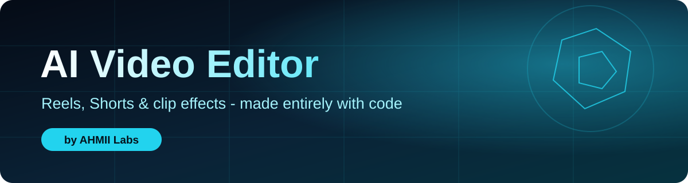
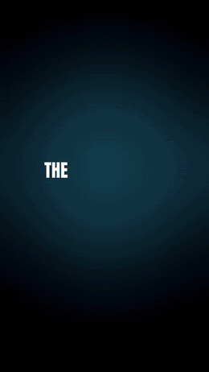

<div align="center">



<br/>


**Turn an idea, a topic or a JSON spec into a finished vertical video, or add pro effects to your own clips. No editing app needed.**

[Demo](#-demo) · [Install](#-install-the-skill) · [What you can say](#-what-you-can-say) · [Commands](docs/COMMANDS.md) · [Features](#-features) · [Limits](#-honest-limits)

</div>

---

## 🎬 Demo

<div align="center">



**[▶ Watch the full demo video (MP4)](demo/AHMII_LABS_Future_Is_Being_Built.mp4)**

<sub>"AHMII LABS - The future is being built": 1080x1920, about 25 seconds, made with this tool.</sub>

</div>

---

## ✨ Features

| | Feature | What it does |
|---|---|---|
| 🎞️ | **Reel renderer** | 5 style packs (kinetic, clean, blueprint, comic, sketch), 17 transitions, Ken-Burns on your own images/videos |
| 🗣️ | **Voice** | Natural offline voice (Kokoro), or bring your own voice note |
| 💬 | **Captions** | Karaoke, highlight and plain styles, SRT export, captions that follow the speaker |
| 🧑‍🎤 | **Person effects** | Text behind person, background replace / blur / remove, smart spotlight |
| 📊 | **Motion graphics** | Glass stat widgets, bar chart split-screen, lower thirds, progress bar |
| 🎨 | **Clip effects** | Spotlight, punch zoom, cinematic zoom, color grade, 9:16 face-follow crop |
| 🔊 | **Audio** | Denoise, loudness, music with ducking, SFX on transitions |
| ✅ | **QA + batch** | 14 automatic checks with JSON report, batch queue with retry and resume |

---

## 🚀 Install the skill

1. Download **`ai-video-editor.skill`** from this repo.
2. Go to **claude.ai → Settings → Features (Capabilities) → Skills** and upload it.
3. Make sure **code execution / file creation** is enabled and your plan supports custom skills (Pro, Max, Team, Enterprise).
4. Start a **new chat** and just talk to Claude.

> Skills are per surface. If you also use Claude Code, upload or install the skill there as well.

<details>
<summary><b>Run it locally instead (Linux / macOS / Termux / Windows)</b></summary>

```bash
cd ai-video-editor
bash install.sh --with-models            # Windows: powershell -File install.ps1 -WithModels
python scripts/env_check.py              # what works on this machine
python scripts/reel.py assets/example-spec.json --out reel.mp4
python -m pytest tests -q                # run the test suite
```

</details>

---

## 💬 What you can say

Just chat with Claude. A few examples (full table in [docs/COMMANDS.md](docs/COMMANDS.md)):

```text
Make a reel: why is tea so expensive on trains? 30 sec, natural voice, comic style
Make a reel in my voice about <topic>, karaoke captions   (attach a voice note)
Add karaoke captions to this video, follow the speaker
Add spotlight and a cinematic color grade to this clip
Put the text "FOCUS" behind me for the first 8 seconds
Change the background to an orange-dark gradient
Add glass widgets: 36 Followers, 197K Reach
Crop this landscape video to 9:16 and follow the face
Give me the transcript and an SRT file
```

---

## 🧠 How it works

```text
TOPIC → script → assets → voice → captions → render (styles + transitions + overlays)
      → audio mix → mux → QA → optional post effects → final MP4
```

Claude is both the script writer and the operator: it writes the JSON spec, runs the scripts, checks the QA report and hands you the MP4. No LLM API key is needed on claude.ai.

---

## 📁 Repository layout

```text
.
├── README.md
├── ai-video-editor.skill        # ready-to-upload Claude skill (zip)
├── docs/COMMANDS.md             # what to say + what Claude runs
├── demo/                        # demo video
├── assets/                      # banner, poster, GIF preview
└── ai-video-editor/             # skill source: scripts, docs, tests, fonts
```

---

## ⚠️ Honest limits

- **Web sandbox:** 1 CPU, draft 720p only, about 35 s of video per run (longer reels are rendered in parts and joined).
- **Network:** only GitHub, PyPI and api.anthropic.com are reachable, so image generation, video generation, cloud transcription and the AI script writer are not available on claude.ai. Your own images and videos are used instead.
- **Urdu script** is not rendered on screen. Use Roman Urdu.
- **Music:** the built-in `synth:` track is only a placeholder pad. Bring your own music.
- Whisper `tiny` is weak on Hindi/Urdu. Word times are interpolated inside real sentence times.

---

<div align="center">

Built by **AHMII Labs** · *Engineering Intelligence. Building Tomorrow.*

</div>
